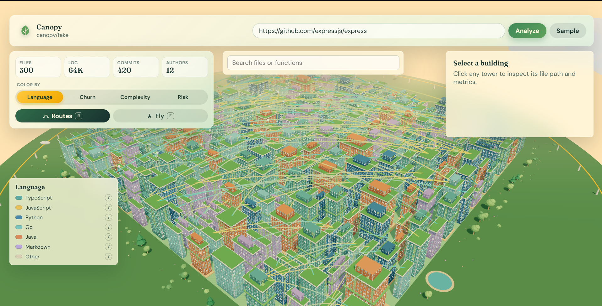
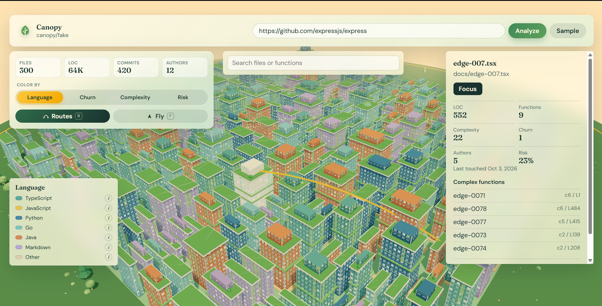
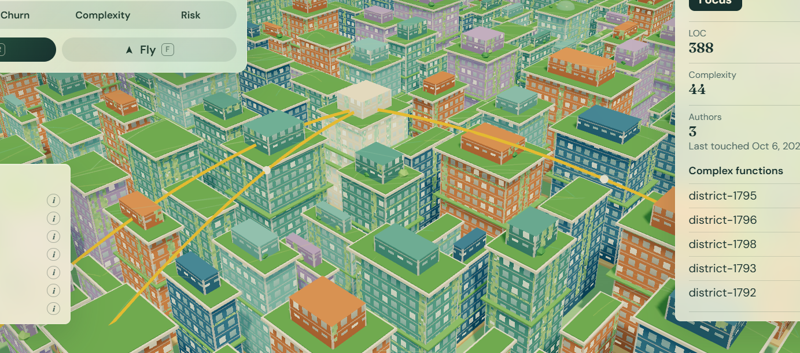
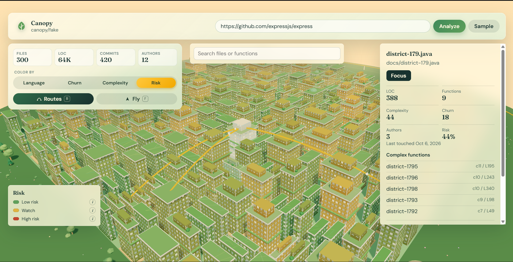
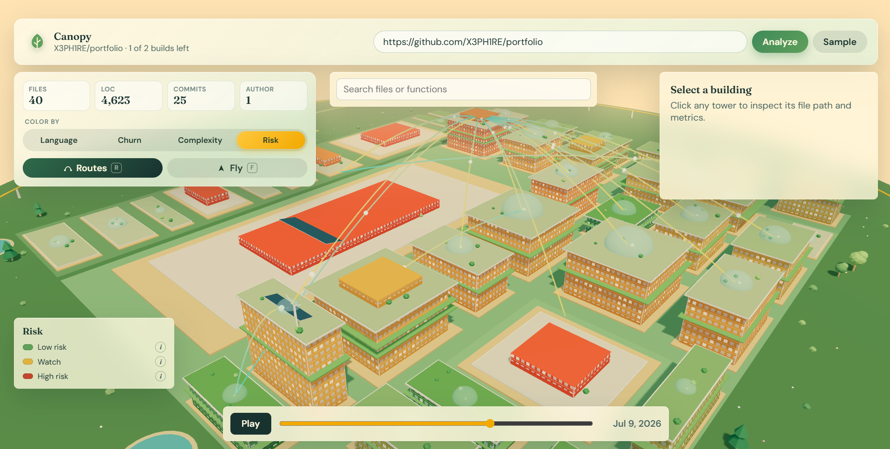
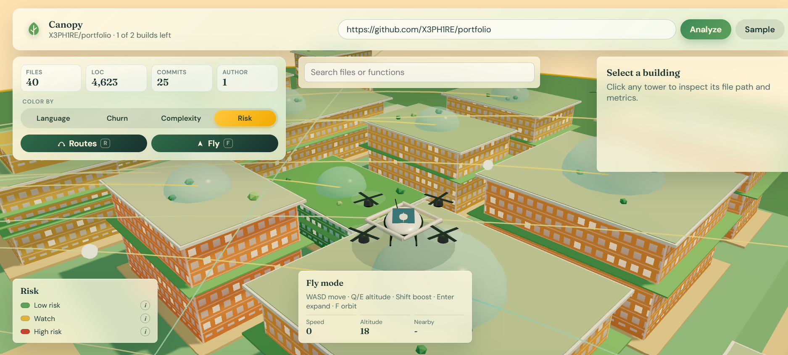

# Canopy

Your codebase, as a city you can fly through.

Paste a public GitHub repository URL and Canopy will analyze its files, dependencies, churn, risk hotspots, and history, then render the result as a navigable 3D city with timeline playback, dependency routes, and search fly-to.

## Project Overview

- **Project name:** Canopy
- **Short description:** A visual codebase explorer where folders become districts, files become buildings, git history becomes a time slider, and risky code glows.
- **Team:** Ashwin Menon ([@X3PH1RE](https://github.com/X3PH1RE))
- **Demo video:** [Watch the demo](https://drive.google.com/file/d/19_4Yk8tpS9wDz5aKTS4FWK5rVLw0-Lc3/view?usp=sharing)
- **Working demo:** Local demo with `pnpm dev`; open `http://localhost:5173`, paste a public GitHub URL, or load the sample city.
- **Technology stack:** TypeScript, pnpm workspaces, Fastify, Vite, React 18, React Three Fiber, Drei, Three.js, Zustand, d3-hierarchy, web-tree-sitter, tree-sitter-wasms, Vitest.

## Screenshots

Add images to `docs/images/` and update the paths below.

| Overview | Building inspector |
| --- | --- |
|  |  |
| _Photo/screenshot: full city in Language view_ | _Photo/screenshot: selected building with metrics_ |

| Dependency routes | Risk view |
| --- | --- |
|  |  |
| _Photo/screenshot: routes highlighted for one file_ | _Photo/screenshot: Risk view_ |

| Timeline | Drone fly mode |
| --- | --- |
|  |  |
| _Photo/screenshot: time slider mid-playback_ | _Photo/screenshot: fly mode with the drone_ |

Team or demo photos: add them under `docs/images/` and link them here.

<!-- Add more photos or screenshots below -->

## Run The Project

### Prerequisites

- Node.js 20.19 or newer
- pnpm 9 or newer

### Install

```bash
pnpm install
```

### Start

```bash
pnpm dev
```

The server listens on `http://localhost:8787` and the web app listens on `http://localhost:5173`.

### Controls

- Click a building to inspect it; use the search box to fly to a file or function.
- `1`-`4` switch view modes, `R` toggles routes, `F` toggles fly mode, space plays the timeline.
- Fly mode: WASD move, Q/E altitude, Shift boost, arrow keys turn, Enter expands the nearby building, Esc dismisses it.

### Environment variables

Optional, set in `apps/server/.env` (see `apps/server/.env.example`): `RATE_LIMIT_ENABLED`, `RATE_LIMIT_MAX`, `RATE_LIMIT_WINDOW_MINUTES`, `TRUST_PROXY`.

### Checks

```bash
pnpm test
pnpm typecheck
pnpm build
```

## Current Status

- Working features: pnpm workspace, shared `CityData` types, Fastify `/api/health`, `/api/limits`, in-memory analyze jobs, safe GitHub URL validation, repo clone/fetch cache, repo walking filters, tree-sitter metrics with heuristic fallback, relative JS/TS/Python dependency edges, git history parsing, timeline data, churn/risk scoring, Language/Churn/Complexity/Risk view modes, deterministic fake city generation, treemap layout tests, generated sample data, a full-screen 3D city scene, district plates, instanced trees, roof solar panels, monorail with moving pods, ponds, bushes and flowers, wind turbines, a painted-window building shader with green roofs, a quadcopter drone model, a legend with info cards, a redesigned stats and controls panel, district labels, view legend, focus-safe keyboard shortcuts, toggleable dependency routes with selection highlights, orbit controls, camera fly-to, file/function search, drone fly mode with collision, chase camera, proximity popups, fly HUD, hover highlighting, click selection, live time-slider playback with smooth building growth and changed-file pulses, inspect panel metrics and dependency lists, URL submission UI, polished progress overlay, friendly rate-limit panel, strict TypeScript checks, and Vitest setup.
- Known limitations: Offline pre-baked real samples are a later phase. Public GitHub analysis needs network access and a running dev server. Frame rate on very large cities has not been measured. See `NOTES.md` for more.
- Libraries, APIs, and public datasets used: Fastify, Vite, React, React Three Fiber, Drei, Three.js, Zustand, TypeScript, Vitest, d3-hierarchy, web-tree-sitter, tree-sitter-wasms, and fontsource packages. No external datasets are used.

See [AI_USAGE.md](AI_USAGE.md) for AI assistance and [CHANGELOG.md](CHANGELOG.md) for the development record.
